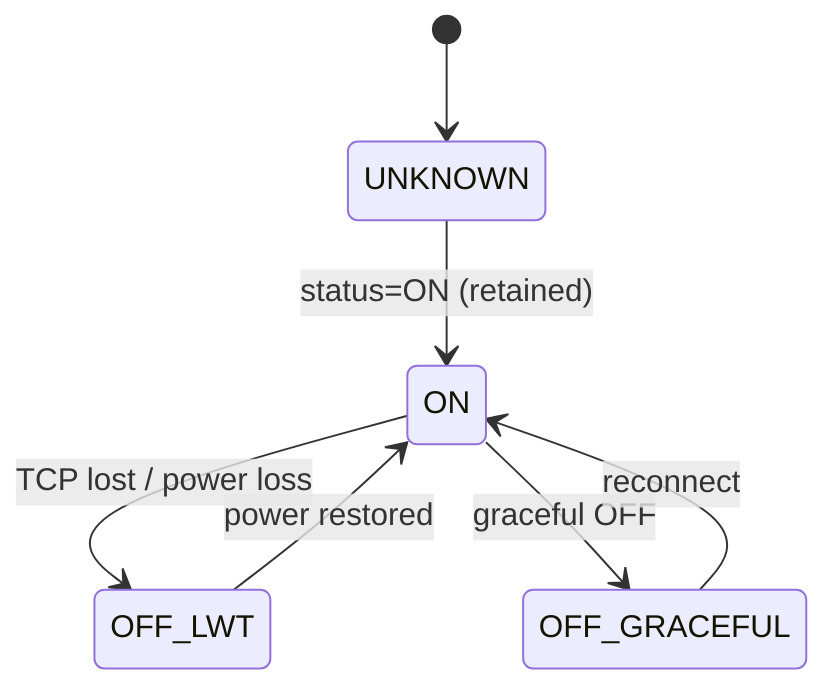
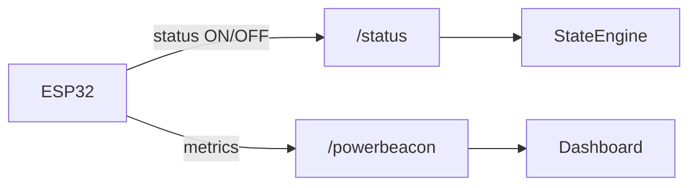
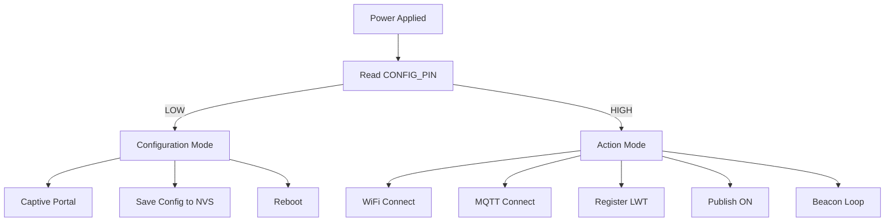
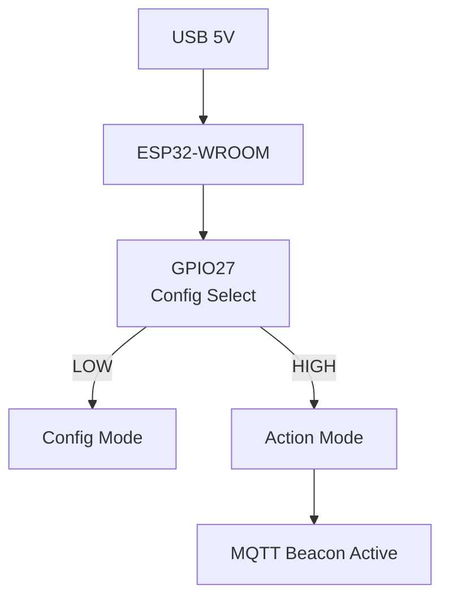
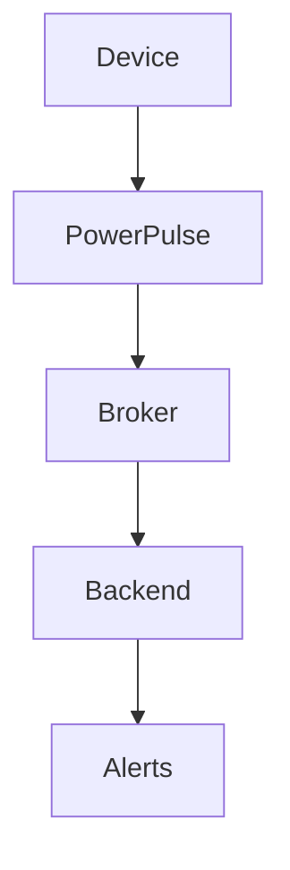

<!-- ================= BADGES ================= -->
<p>
  
  
  
  
  
  
  
  <a href="https://github.com/855princekumar/sense-hive"></a>
  <a href="https://github.com/855princekumar/powerpulse/actions/workflows/ci.yml"></a>
</p>
<!-- ==================================================== -->


# **PowerPulse**

## A Power Presence Beacon Built the Hard Way

**Hardware:** ESP32-WROOM (prototype), ESP32-C3 (planned)

---

## Why This Exists (The Real Problem, Not the Sanitized One)

This project did not start as *“let’s build an IoT product.”*

It started as a very frustrating operational reality.

Across campuses, labs, and distributed setups, I had **devices deployed everywhere**: routers, gateways, small PCs, edge nodes - the kind of infrastructure nobody notices until it breaks.

Most of these devices **did not have power backup**.
Not because we didn’t care, but because:

* UPS everywhere is expensive
* Maintenance is painful
* Batteries fail silently
* And people forget to replace them

So when a device went down, the monitoring stack would politely report:

> *“Host unreachable”*

Which is monitoring-speak for:

> *“Good luck figuring this out.”*

Was it:

* power loss?
* LAN outage?
* WiFi glitch?
* device crash?
* someone accidentally unplugged it?

The system didn’t know.
And worse - **neither did we**.

That uncertainty costs time, confidence, and unnecessary troubleshooting.

---

## Why This Is Better Than “Heartbeat Missing = OFF”

Heartbeat loss is ambiguous.

* WiFi hiccup?
* Broker restart?
* Packet loss?

PowerPulse avoids this entirely.

The broker:

* only publishes LWT when TCP dies uncleanly
* only retains OFF when it’s confident
* never guesses

That’s why the system is calm instead of jumpy.

---

## Firmware Versions and Post-Deployment Hardening

PowerPulse firmware is versioned to reflect **real operational learning**, not feature churn.

Both firmware versions are intentionally retained in the repository to document how the system evolved under live conditions.

### PowerBeacon v1.0 – Baseline Release

**Status:** In-house validated
**Purpose:** Prove correct power presence semantics

v1.0 established the architectural correctness of PowerPulse:

* Broker-driven OFF detection using MQTT LWT
* Retained `/status` as the single source of truth
* No hardware power sensing
* Captive portal configuration
* LAN-first with fallback broker support

This version confirmed the **core idea was sound**.

---

### What Happened in Live Operation

After continuous real-world runtime, a few issues surfaced that only appear on real networks:

| Observed Issue   | Root Cause                     | Impact                      |
| ---------------- | ------------------------------ | --------------------------- |
| False OFF events | Short WiFi outages             | Alert noise                 |
| Reboot cascades  | Aggressive reboot on WiFi loss | LWT misfires                |
| Delayed startup  | Blocking NTP sync              | Late state visibility       |
| Silent hangs     | No watchdog                    | Manual power reset required |

These issues did not break correctness, but they reduced operational confidence.

---

### PowerBeacon v1.1 – Stability Patch

**Status:** Recommended for deployment
**Purpose:** Eliminate false OFF signals and harden runtime behavior

v1.1 applies **stability-focused patches only**, without altering topics, payloads, or backend expectations.

#### Changes Applied

1. **Timed WiFi reconnect**

   * Reconnect attempts every 5 seconds
   * Reboot only after ~90 seconds of continuous failure
   * Short WiFi glitches no longer cause OFF events

2. **Non-blocking NTP**

   * MQTT connects immediately
   * LWT registered immediately
   * Timestamp updates asynchronously
   * Uptime-based timestamps used until time sync resolves

3. **Task watchdog enabled**

   * Automatic recovery from rare firmware stalls
   * No impact on normal operation
   * OFF detection remains broker-driven

---

### Firmware Behavior Comparison

| Aspect                    | v1.0             | v1.1         |
| ------------------------- | ---------------- | ------------ |
| MQTT topics               | Same             | Same         |
| JSON payload              | Same             | Same         |
| OFF detection             | LWT              | LWT          |
| WiFi handling             | Immediate reboot | Timed retry  |
| False OFF events          | Possible         | Eliminated   |
| NTP dependency            | Blocking         | Non-blocking |
| Watchdog                  | Not enabled      | Enabled      |
| Deployment recommendation | Reference        | Recommended (v1.x topics); v2.0 for SenseHive |

---

### Backward Compatibility

PowerBeacon v1.1 is fully backward compatible.

* No topic changes
* No payload changes
* No backend updates required

Existing dashboards, Node-RED flows, and alerting logic continue to work unchanged.

---

### PowerPulse v2.0 – Made for SenseHive

**Status:** Recommended for new nodes
**Purpose:** Flash it, plug it in, and [SenseHive](https://github.com/855princekumar/sense-hive) finds it

v2.0 comes in two builds of one sketch:

| Build | Folder | In SenseHive |
| ----- | ------ | ------------ |
| **Auto-discovery** (secure) | [`Firmware/PowerPulse-v2.0-auto`](Firmware/PowerPulse-v2.0-auto) | Appears by itself under **Secure topics**: the beacon is encrypted and signed with a per-node key from SenseHive, so only SenseHive can read it, even on a public broker |
| **Manual** (plain) | [`Firmware/PowerPulse-v2.0-manual`](Firmware/PowerPulse-v2.0-manual) | Add the topic and its status topic by hand under **Open topics** |

Quick start (auto-discovery):

1. SenseHive 1.7+: **Topic logs**, **Secure topics**, **Generate keys** (one per node), download the CSV.
2. Put one key id and key in `Firmware/PowerPulse-v2.0-auto/config.h` (or enter them later in the setup portal).
3. Upload to the ESP32 and power it. It joins Wi-Fi (or opens the `PowerPulse-Setup` portal), and SenseHive shows it within seconds, online; a power cut shows it offline.

What else changed (both builds):

* Settings in `config.h` or the portal; saved portal values win
* A unique default base topic per board (`powerpulse-<MAC>`) instead of `espnode-1`
* Built-in SNTP time with UTC ISO timestamps (no NTPClient library)
* 1 KB MQTT buffer, so a long or sealed beacon is never dropped
* The beacon is never retained (v1.1 passed the QoS as the retain flag)
* The watchdog is armed after Wi-Fi setup, so an open portal cannot trip it; the portal restarts the node after 5 minutes
* `<base>/status` is unchanged: existing dashboards and alerts keep working

Tested on every change: both builds compile for the ESP32, the firmware's encryption code is checked byte for byte against SenseHive, a simulated node runs end to end against SenseHive and a real broker (auto-discovery, manual addition, power cut, forged and copied keys refused), and the real firmware runs on a simulated ESP32 in [Wokwi](https://wokwi.com).

<p align="center">
  
</p>

**Full guide:** [docs/SENSEHIVE.md](docs/SENSEHIVE.md): minimum requirements, both builds step by step, uploading, the portal, topics, how auto-discovery works, tests and troubleshooting.

---

## The Obvious Solutions (And Why They All Sucked)

Like any sane engineer, I tried existing solutions first.

Smart plugs.
Energy meters.
Commercial monitoring hardware.
Industrial automation vendors.
Amazon-grade IoT gadgets.

They all promised *“visibility.”*

What they actually delivered was:

* dashboards nobody asked for
* mobile apps nobody wanted
* batteries that defeated the purpose
* cloud lock-in
* BOM costs that made large-scale deployment laughable

Most of them were trying to **measure power**.

I didn’t need to measure power.
I just needed to **know if power existed**.

That distinction matters more than most products admit.

---

## The Thought That Changed Everything

One simple question changed the entire design:

> *What if I stop trying to measure power… and just let power reveal itself?*

If a tiny node:

* is powered from the **same source** as the device
* has **no battery**
* has **no backup**
* and disappears the moment power disappears

Then that node is already telling the truth.

No ADC.
No CT clamp.
No voltage divider.
No calibration.

Just existence.

That’s when PowerPulse stopped being an idea and became a system.

---

## What PowerPulse Actually Is

PowerPulse is a **power presence beacon**.

Not a power meter.
Not a smart plug.
Not an energy analytics platform.

It answers exactly one question - very reliably:

> **Is this device powered right now?**

It does that by:

* sharing the same power source as the monitored device
* publishing its own life as a signal
* letting the messaging infrastructure decide when it’s dead

That’s it.

Everything else is noise.

---

## System Architecture (High-Level View)

This diagram is the **mental model** of PowerPulse.

```
+-----------------------------+
|   Monitored Device          |
| (Router / Gateway / PC)     |
+-------------+---------------+
              |
              | Shared Power Source
              |
+-------------v---------------+
|   PowerPulse Beacon         |
|   (ESP32-WROOM / ESP32-C3)  |
|                             |
| - No battery                |
| - No power sensing          |
| - Same power input          |
+-------------+---------------+
              |
              | WiFi (LAN / Internet)
              |
+-------------v--------------------------+
|            MQTT Broker                 |
|                                        |
| - Retained status                      |
| - LWT handling                         |
| - Session awareness                    |
+-------------+--------------------------+
              |
+-------------v--------------------------+
|        Backend / Dashboard             |
|                                        |
| - Node-RED / Services                  |
| - Alerts                               |
| - KPIs                                 |
+----------------------------------------+
```

**Key idea:**
PowerPulse does not decide it is OFF - **the broker does**.

---

## Why the Hardware Is Almost Insultingly Simple

Here’s the prototype hardware:

* ESP32-WROOM dev board
* One jumper wire
* One USB cable

That’s not minimal because I’m lazy.
It’s minimal because **every extra component lies eventually**.

No battery - because batteries mask failure.
No sensors - because sensors drift, fail, and add cost.
No display - because retained MQTT messages already do that job better.

The hardware has exactly one responsibility:

> **Exist when power exists. Vanish when it doesn’t.**

Everything else happens in firmware.

---

### Hardware Reference: ESP32 Dev Kit Used in Prototype

The PowerPulse prototype uses a **standard ESP32 Dev Kit V1**.
There is no custom PCB, no hidden circuitry, and no special pin requirements.

<!-- IMAGE PLACEHOLDER: ESP32 PINOUT -->


Only **one GPIO** is actively used by the firmware.
All other pins remain untouched and available.

---

## Why Firmware Does the Heavy Lifting

Once hardware stops pretending to be clever, firmware has to be.

This is where many “simple IoT projects” quietly collapse.

PowerPulse firmware had to solve questions like:

* How do I signal OFF **without running code**?
* How do I avoid false OFF during WiFi glitches?
* How do I distinguish power loss from a planned reboot?
* How do I survive LAN outages without lying?

The answer turned out to be:
**MQTT semantics, used correctly.**

---

## MQTT: Not as Transport, but as Truth

Most projects use MQTT like this:

> publish → subscribe → hope for the best

PowerPulse uses MQTT like this:

> **the broker decides when I’m dead**

### MQTT State Authority (Mermaid)



This dual OFF path is the core reliability feature.

---

## What the Subscriber Actually Sees (This Matters)

There are exactly **two topics that matter**.

### `<base>/status` - The Truth (Retained)

```json
{
  "node_id": "espnode-1",
  "location": "Rack-A1",
  "status": "ON",
  "reason": "alive"
}
```

Power loss (broker-generated LWT):

```json
{
  "node_id": "espnode-1",
  "location": "Rack-A1",
  "status": "OFF",
  "reason": "lwt"
}
```

Planned reboot / network loss:

```json
{
  "node_id": "espnode-1",
  "location": "Rack-A1",
  "status": "OFF",
  "reason": "graceful"
}
```

### `<base>/powerbeacon` - Telemetry (Not State)



**Design rule:**
Telemetry never changes state.

---

## Boot & Mode Selection Flow



---

## How I Actually Built This (Step by Step)

### Hardware

* ESP32-WROOM dev board
* USB power shared with target device
* Optional jumper wire for config mode

<!-- IMAGE PLACEHOLDER: REAL PROTOTYPE -->


---

### GPIO Usage (Prototype)

| Pin    | Usage                     | Reason               |
| ------ | ------------------------- | -------------------- |
| GPIO27 | Configuration mode select | Internally pulled up |
| GND    | Config reference          | Deterministic        |
| USB 5V | Power input               | Shared with device   |
| UART   | Flashing / debug          | Dev only             |



---

## Why This Is Better Than “Heartbeat Missing = OFF”

Heartbeat loss is ambiguous.

* WiFi hiccup?
* Broker restart?
* Packet loss?

PowerPulse avoids this entirely.

The broker:

* only publishes LWT when TCP dies uncleanly
* only retains OFF when it’s confident
* never guesses

That’s why the system is calm instead of jumpy.

---

## How to Replicate PowerPulse in 30 Minutes (No Excuses)

If this can’t be reproduced quickly, the design has failed.

**Steps:**

1. Install Arduino IDE
2. Add ESP32 board support
3. Install required libraries
4. Flash firmware
5. Boot in config mode
6. Enter WiFi + MQTT + topic + location
7. Reboot and observe

Pull power.
Watch OFF appear.

That’s the system working.

---

## Deployment Playbook (How This Is Meant to Be Used)



### Rules

1. PowerPulse must share power with the device
2. One beacon per failure domain
3. Location tags are operational data
4. `<base>/status` is the only truth
5. LWT is non-negotiable

---

## Cost BOM (INR)

### Prototype BOM

| Item                  | Cost (INR)  |
| --------------------- | ----------- |
| ESP32-WROOM Dev Board | ₹350 – ₹500 |
| USB Cable             | ₹50 – ₹100  |
| USB Adapter           | ₹150 – ₹250 |
| Jumper Wire           | ₹10 – ₹20   |
| 3D Printed Enclosure  | ₹50 – ₹80   |

**Total:** **₹610 – ₹950**

---

### Production Direction

| Item               | Cost (INR)  |
| ------------------ | ----------- |
| ESP32-C3           | ₹220 – ₹300 |
| USB-C Connector    | ₹20 – ₹30   |
| Custom PCB         | ₹80 – ₹120  |
| Snap-fit Enclosure | ₹40 – ₹60   |
| USB Adapter        | ₹120 – ₹180 |

**Projected:** **₹480 – ₹650**

---

## The “Sarcastic but True” Section

Things I intentionally did *not* add:

* A battery (because it would lie)
* A current sensor (because it would drift)
* A mobile app (because nobody wants another one)
* AI/ML (because this problem does not need it)
* Cloud dependency (because LANs exist)
* OTA (yet - because bricking devices mid-POC is a bad day)

Sometimes the smartest feature is restraint.

---

## Where This Goes Next


Only the transport changes.
The semantics stay untouched.

---

## Final Words

PowerPulse is not flashy.

It doesn’t glow.
It doesn’t beep.
It doesn’t measure watts.

It simply tells the truth about power.

And in infrastructure, that’s worth more than most dashboards.

---


