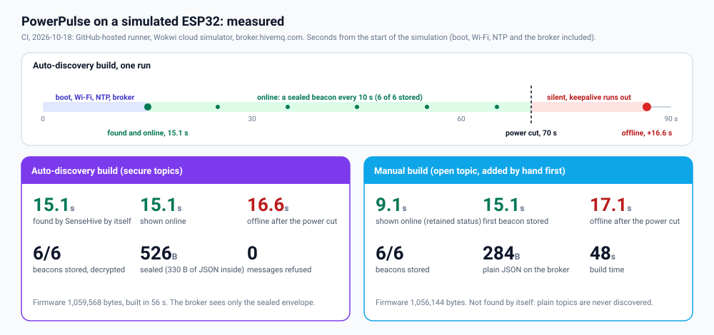
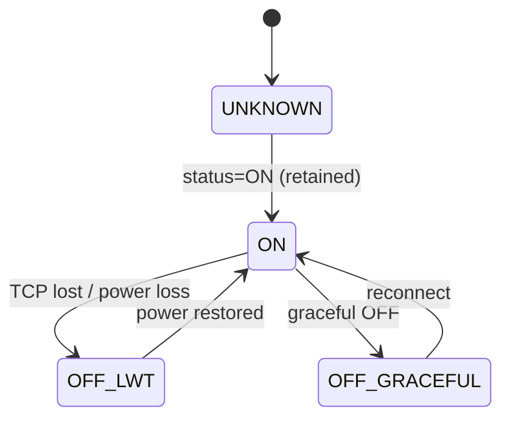
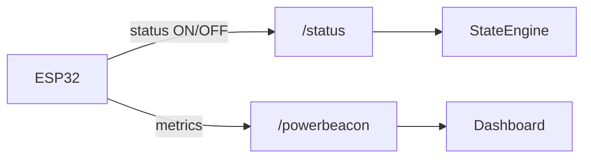
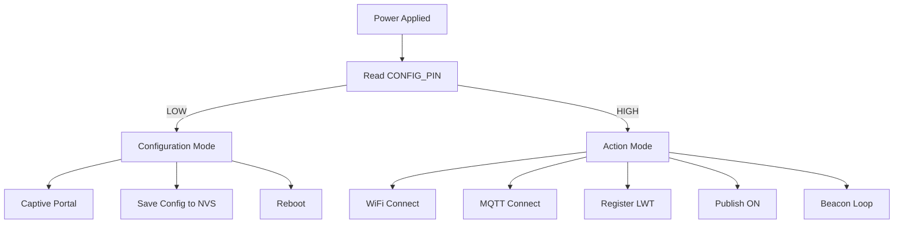

<!-- ================= BADGES ================= -->
<p>
  
  
  
  
  
  
  
  <a href="https://github.com/855princekumar/sense-hive"></a>
  <a href="https://github.com/855princekumar/powerpulse/actions/workflows/ci.yml"></a>
</p>
<!-- ==================================================== -->

# **PowerPulse**

## A Power Presence Beacon Built the Hard Way

PowerPulse answers one question, very reliably: **is this device powered right
now?** A small ESP32, powered from the same source as the device it watches,
announces itself over MQTT and leaves a last will with the broker. When the
power goes, the ESP32 goes with it, and the **broker** says OFF. No battery,
no sensor, no guessing.

| | |
| --- | --- |
| **Hardware** | ESP32-WROOM (prototype), ESP32-C3 (planned); about ₹610 to ₹950 per node |
| **Firmware** | v2.0 in two builds: **auto-discovery** (encrypted, found by [SenseHive](https://github.com/855princekumar/sense-hive) by itself) and **manual** (plain MQTT, any dashboard) |
| **Power loss shown** | about 17 s after the plug is pulled (measured, [below](#3-real-stats-measured)) |
| **Needs** | 2.4 GHz Wi-Fi with internet (time, and the public broker if you use it) |

---

## Contents

1. [Quick start](#1-quick-start)
2. [Setup](#2-setup)
3. [Real stats (measured)](#3-real-stats-measured)
4. [Benchmarks, resources and cost](#4-benchmarks-resources-and-cost)
5. [How it works](#5-how-it-works)
6. [Firmware versions](#6-firmware-versions)
7. [Testing and CI](#7-testing-and-ci)
8. [The story behind PowerPulse](#8-the-story-behind-powerpulse)
9. [Where this goes next](#9-where-this-goes-next)

Full SenseHive guide: [docs/SENSEHIVE.md](docs/SENSEHIVE.md).

---

## 1. Quick start

### With SenseHive: flash it, plug it in, it appears by itself (recommended)

1. **In SenseHive** (1.7+): **Topic logs**, **Secure topics**, **Generate keys**
   (one per node, give it a label such as `pump-house`), **Download CSV**.
2. **In [`Firmware/PowerPulse-v2.0-auto/config.h`](Firmware/PowerPulse-v2.0-auto/config.h)**
   put one row of the CSV:
   ```c
   #define SH_KEY_ID "0123456789abcdef"     // key_id from the CSV
   #define SH_KEY    "0011...(64 hex)...eeff"  // key from the CSV
   ```
   and, optionally, your Wi-Fi (`PP_WIFI_SSID`, `PP_WIFI_PASS`).
3. **Upload** to the ESP32 ([how](#flash-the-firmware)) and power it from the
   same source as the device. Within seconds it appears in SenseHive under
   **Secure topics**, **online**. Pull the plug: it shows **offline**.

### Manual: plain MQTT, any dashboard

1. Optionally set Wi-Fi, broker and `PP_BASE_TOPIC` in
   [`Firmware/PowerPulse-v2.0-manual/config.h`](Firmware/PowerPulse-v2.0-manual/config.h).
2. Upload and power it. The serial monitor (115200 baud) prints its topics.
3. Subscribe to `<base>/status` (the truth: ON or OFF) and `<base>/powerbeacon`
   (telemetry). In SenseHive: **Add Node**, topic `<base>/powerbeacon`, last will
   topic `<base>/status`.

### No toolchain: ready-made firmware

Every CI run builds both firmwares with an empty `config.h` (artifact
`powerpulse-v2.0-firmware`). Flash with
`esptool.py write_flash 0x0 PowerPulse-v2.0-auto.ino.merged.bin`, then set
everything in the [setup portal](#settings-configh-or-the-setup-portal).

---

## 2. Setup

### Hardware

* ESP32-WROOM dev board (a standard ESP32 Dev Kit V1; no custom PCB, no hidden circuitry)
* USB power **shared with the monitored device** (the whole point)
* Optional jumper wire from **GPIO27 to GND** for the setup portal


| Pin    | Usage                     | Reason               |
| ------ | ------------------------- | -------------------- |
| GPIO27 | Configuration mode select | Internally pulled up |
| GND    | Config reference          | Deterministic        |
| USB 5V | Power input               | Shared with device   |
| UART   | Flashing / debug          | Dev only             |

Only **one GPIO** is used; every other pin stays free.

### Choose the build

| Build | Folder | Use it when |
| ----- | ------ | ----------- |
| **Auto-discovery** | [`Firmware/PowerPulse-v2.0-auto`](Firmware/PowerPulse-v2.0-auto) | You use SenseHive and want nodes to appear by themselves, encrypted and signed (safe on a public broker) |
| **Manual** | [`Firmware/PowerPulse-v2.0-manual`](Firmware/PowerPulse-v2.0-manual) | Plain MQTT for any dashboard, Node-RED or alerting that already reads `<base>/status` |
| v1.1 (legacy) | [`Firmware/PowerBeacon-v1.1`](Firmware/PowerBeacon-v1.1) | Existing v1.x fleets; same topics as v2.0 manual |

### Flash the firmware

**Arduino IDE 2:** add the ESP32 boards
(`https://espressif.github.io/arduino-esp32/package_esp32_index.json`, Boards
Manager, **esp32 by Espressif** 3.x), install **WiFiManager** (tzapu) 2.0.17,
**PubSubClient** 2.8 and **ArduinoJson** 7, open the `.ino`, choose
**ESP32 Dev Module**, Upload.

**arduino-cli:**

```bash
arduino-cli core install esp32:esp32@3.3.12
arduino-cli lib install "WiFiManager@2.0.17" "PubSubClient@2.8" "ArduinoJson@7.4.2"
arduino-cli compile --fqbn esp32:esp32:esp32 Firmware/PowerPulse-v2.0-auto
arduino-cli upload  --fqbn esp32:esp32:esp32 -p /dev/ttyUSB0 Firmware/PowerPulse-v2.0-auto
```

### Settings: config.h or the setup portal

Fill `config.h` before uploading (Wi-Fi, broker, base topic, location, and for
the auto build the SenseHive key), **or** hold **GPIO27 to GND** at power-on,
join the Wi-Fi **PowerPulse-Setup** and open `192.168.4.1`. Portal values are
saved on the board and win over `config.h`; the portal closes after 5 minutes.
An empty base topic becomes `powerpulse-<last 6 MAC digits>`, unique per board.

### Topics and messages

| Topic | Retained | What |
| ----- | -------- | ---- |
| `<base>/status` | yes | **The truth.** `{"status":"ON"}` on connect; `{"status":"OFF","reason":"lwt"}` from the broker when the node disappears |
| `<base>/powerbeacon` | no | Telemetry every 10 s (manual build): `node_id, location, ip, mac, uptime_sec, wifi_ssid, rssi_dbm, broker, firmware, status, timestamp` |
| `sensehive/secure/<base>/powerbeacon` | no | The same beacon, sealed for SenseHive (auto build) |

Power loss, as a subscriber sees it (broker-generated last will):

```json
{ "node_id": "espnode-1", "location": "Rack-A1", "status": "OFF", "reason": "lwt" }
```

**Design rule:** telemetry never changes state. Only `<base>/status` does.

### Deployment rules

1. PowerPulse must share power with the device
2. One beacon per failure domain
3. Location tags are operational data
4. `<base>/status` is the only truth
5. LWT is non-negotiable

---

## 3. Real stats (measured)

The real v2.0 firmware, run on a simulated ESP32 in [Wokwi](https://wokwi.com)
against SenseHive over the public broker, measured by CI (every run prints the
same numbers on its summary page):

<p align="center">
  
</p>

What that run validates, end to end:

<p align="center">
  
</p>

**From live operation (v1.0, in-house).** Continuous real-world runtime showed
what only real networks show; v1.1 fixed each, v2.0 kept the fixes:

| Observed Issue   | Root Cause                     | Impact                      | Fixed in |
| ---------------- | ------------------------------ | --------------------------- | -------- |
| False OFF events | Short WiFi outages             | Alert noise                 | v1.1 |
| Reboot cascades  | Aggressive reboot on WiFi loss | LWT misfires                | v1.1 |
| Delayed startup  | Blocking NTP sync              | Late state visibility       | v1.1 |
| Silent hangs     | No watchdog                    | Manual power reset required | v1.1 |

---

## 4. Benchmarks, resources and cost

| | Auto-discovery build | Manual build |
| --- | --- | --- |
| Firmware size | 1,059,568 bytes (80 % of the default app partition) | 1,056,144 bytes |
| RAM used (globals) | about 50 KB of 320 KB | about 48 KB |
| Message on the broker | 526 bytes sealed (330 bytes of JSON inside) | 284 bytes |
| Beacon interval | 10 s | 10 s |
| Online after power-on (simulated, incl. Wi-Fi, NTP, broker) | 15.1 s | 9.1 s |
| Offline after power loss (broker keepalive 15 s) | 16.6 s | 17.1 s |
| Build time (CI) | 56 s | 48 s |

**Prototype BOM (INR)**

| Item                  | Cost (INR)  |
| --------------------- | ----------- |
| ESP32-WROOM Dev Board | ₹350 – ₹500 |
| USB Cable             | ₹50 – ₹100  |
| USB Adapter           | ₹150 – ₹250 |
| Jumper Wire           | ₹10 – ₹20   |
| 3D Printed Enclosure  | ₹50 – ₹80   |

**Total:** **₹610 – ₹950**

**Production direction (INR)**

| Item               | Cost (INR)  |
| ------------------ | ----------- |
| ESP32-C3           | ₹220 – ₹300 |
| USB-C Connector    | ₹20 – ₹30   |
| Custom PCB         | ₹80 – ₹120  |
| Snap-fit Enclosure | ₹40 – ₹60   |
| USB Adapter        | ₹120 – ₹180 |

**Projected:** **₹480 – ₹650**

---

## 5. How it works

```
+-----------------------------+
|   Monitored Device          |
| (Router / Gateway / PC)     |
+-------------+---------------+
              |
              | Shared Power Source
              |
+-------------v---------------+
|   PowerPulse Beacon         |
|   (ESP32-WROOM / ESP32-C3)  |
|                             |
| - No battery                |
| - No power sensing          |
| - Same power input          |
+-------------+---------------+
              |
              | WiFi (LAN / Internet)
              |
+-------------v--------------------------+
|            MQTT Broker                 |
|                                        |
| - Retained status                      |
| - LWT handling                         |
| - Session awareness                    |
+-------------+--------------------------+
              |
+-------------v--------------------------+
|        Backend / Dashboard             |
|                                        |
| - SenseHive / Node-RED / Services      |
| - Alerts                               |
| - KPIs                                 |
+----------------------------------------+
```

**Key idea:** PowerPulse does not decide it is OFF - **the broker does**.

### MQTT: not as transport, but as truth

Most projects use MQTT like this:

> publish → subscribe → hope for the best

PowerPulse uses MQTT like this:

> **the broker decides when I’m dead**





### Why this is better than “heartbeat missing = OFF”

Heartbeat loss is ambiguous.

* WiFi hiccup?
* Broker restart?
* Packet loss?

PowerPulse avoids this entirely. The broker:

* only publishes LWT when TCP dies uncleanly
* only retains OFF when it’s confident
* never guesses

That’s why the system is calm instead of jumpy.

### Boot and mode selection



### With SenseHive (auto-discovery)

The auto build seals every beacon with its own key from SenseHive (AES-256-CTR
and HMAC-SHA256, SenseHive's protocol sst1, with the ESP32's built-in mbedTLS)
and names its plain status topic inside the signed message. SenseHive checks
the key, the topic, the time and the signature, decrypts, adds the topic by
itself and follows the status topic for online and offline. Only SenseHive can
read the beacon, even on a public broker. Details: [docs/SENSEHIVE.md](docs/SENSEHIVE.md#how-auto-discovery-works).

---

## 6. Firmware versions

PowerPulse firmware is versioned to reflect **real operational learning**, not
feature churn. Every version is kept in the repository to document how the
system evolved under live conditions.

| Aspect                    | v1.0             | v1.1         | v2.0 |
| ------------------------- | ---------------- | ------------ | ---- |
| MQTT topics               | Same             | Same         | Same `<base>/status`; secure beacon topic in the auto build |
| OFF detection             | LWT              | LWT          | LWT |
| WiFi handling             | Immediate reboot | Timed retry  | Timed retry |
| False OFF events          | Possible         | Eliminated   | Eliminated |
| NTP dependency            | Blocking         | Non-blocking | Non-blocking (built-in SNTP) |
| Watchdog                  | Not enabled      | Enabled      | Enabled, after Wi-Fi setup |
| Settings                  | Portal           | Portal       | `config.h` or portal |
| Works with SenseHive      | Manual topics    | Manual topics | Auto-discovery or manual |
| Deployment recommendation | Reference        | Existing v1.x fleets | **New nodes** |

### PowerPulse v2.0 – Made for SenseHive

**Status:** Recommended for new nodes.
**Purpose:** Flash it, plug it in, and SenseHive finds it.

* Two builds of one sketch: auto-discovery (secure) and manual (plain)
* Settings in `config.h` or the portal; saved portal values win
* A unique default base topic per board (`powerpulse-<MAC>`) instead of `espnode-1`
* Built-in SNTP time with UTC ISO timestamps (no NTPClient library)
* 1 KB MQTT buffer, so a long or sealed beacon is never dropped
* The beacon is never retained (v1.1 passed the QoS as the retain flag)
* The watchdog is armed after Wi-Fi setup, so an open portal cannot trip it; the portal restarts the node after 5 minutes
* `<base>/status` is unchanged: existing dashboards and alerts keep working

### PowerBeacon v1.1 – Stability Patch

**Status:** For existing v1.x fleets.
**Purpose:** Eliminate false OFF signals and harden runtime behavior, without
altering topics, payloads, or backend expectations.

1. **Timed WiFi reconnect:** attempts every 5 seconds, reboot only after about
   90 seconds of continuous failure, so short WiFi glitches no longer cause OFF.
2. **Non-blocking NTP:** MQTT and the LWT register immediately; timestamps
   update asynchronously (uptime-based until time sync resolves).
3. **Task watchdog:** automatic recovery from rare firmware stalls; OFF
   detection stays broker-driven.

Fully backward compatible: no topic or payload changes, no backend updates.

### PowerBeacon v1.0 – Baseline Release

**Status:** In-house validated. **Purpose:** Prove correct power presence semantics.

* Broker-driven OFF detection using MQTT LWT
* Retained `/status` as the single source of truth
* No hardware power sensing
* Captive portal configuration
* LAN-first with fallback broker support

This version confirmed the **core idea was sound**.

---

## 7. Testing and CI

Every push, every pull request, and weekly against SenseHive's latest `main`:

| Test | What it proves |
| ---- | -------------- |
| Firmware builds | Both v2.0 builds compile for the ESP32, as shipped and with every setting filled in; the two sketches are the same file |
| The firmware's encryption | `sensehive_secure.h`, compiled on a PC, produces **byte for byte** what SenseHive produces, and SenseHive opens it |
| End to end, simulated node | SenseHive and a real broker: the auto build appears by itself, shows online, then offline on a power cut; the manual build is ignored until added; forged messages and copied keys are refused |
| Real firmware, simulated ESP32 | Wokwi runs the compiled firmware with Wi-Fi and internet against SenseHive over the public broker, both builds ([numbers above](#3-real-stats-measured)) |
| Repository checks | No secrets filled in `config.h`, no em dashes, lint, CodeQL |

Run them on your own machine: [docs/SENSEHIVE.md](docs/SENSEHIVE.md#how-it-is-tested).

---

## 8. The story behind PowerPulse

### Why this exists (the real problem, not the sanitized one)

This project did not start as *“let’s build an IoT product.”*

It started as a very frustrating operational reality.

Across campuses, labs, and distributed setups, I had **devices deployed everywhere**: routers, gateways, small PCs, edge nodes - the kind of infrastructure nobody notices until it breaks.

Most of these devices **did not have power backup**.
Not because we didn’t care, but because:

* UPS everywhere is expensive
* Maintenance is painful
* Batteries fail silently
* And people forget to replace them

So when a device went down, the monitoring stack would politely report:

> *“Host unreachable”*

Which is monitoring-speak for:

> *“Good luck figuring this out.”*

Was it:

* power loss?
* LAN outage?
* WiFi glitch?
* device crash?
* someone accidentally unplugged it?

The system didn’t know.
And worse - **neither did we**.

That uncertainty costs time, confidence, and unnecessary troubleshooting.

### The obvious solutions (and why they all sucked)

Like any sane engineer, I tried existing solutions first.

Smart plugs.
Energy meters.
Commercial monitoring hardware.
Industrial automation vendors.
Amazon-grade IoT gadgets.

They all promised *“visibility.”*

What they actually delivered was:

* dashboards nobody asked for
* mobile apps nobody wanted
* batteries that defeated the purpose
* cloud lock-in
* BOM costs that made large-scale deployment laughable

Most of them were trying to **measure power**.

I didn’t need to measure power.
I just needed to **know if power existed**.

That distinction matters more than most products admit.

### The thought that changed everything

One simple question changed the entire design:

> *What if I stop trying to measure power… and just let power reveal itself?*

If a tiny node:

* is powered from the **same source** as the device
* has **no battery**
* has **no backup**
* and disappears the moment power disappears

Then that node is already telling the truth.

No ADC.
No CT clamp.
No voltage divider.
No calibration.

Just existence.

That’s when PowerPulse stopped being an idea and became a system.

### What PowerPulse actually is

PowerPulse is a **power presence beacon**.

Not a power meter.
Not a smart plug.
Not an energy analytics platform.

It answers exactly one question - very reliably:

> **Is this device powered right now?**

It does that by:

* sharing the same power source as the monitored device
* publishing its own life as a signal
* letting the messaging infrastructure decide when it’s dead

That’s it.

Everything else is noise.

### Why the hardware is almost insultingly simple

Here’s the prototype hardware:

* ESP32-WROOM dev board
* One jumper wire
* One USB cable

That’s not minimal because I’m lazy.
It’s minimal because **every extra component lies eventually**.

No battery - because batteries mask failure.
No sensors - because sensors drift, fail, and add cost.
No display - because retained MQTT messages already do that job better.

The hardware has exactly one responsibility:

> **Exist when power exists. Vanish when it doesn’t.**

Everything else happens in firmware.

### Why firmware does the heavy lifting

Once hardware stops pretending to be clever, firmware has to be.

This is where many “simple IoT projects” quietly collapse.

PowerPulse firmware had to solve questions like:

* How do I signal OFF **without running code**?
* How do I avoid false OFF during WiFi glitches?
* How do I distinguish power loss from a planned reboot?
* How do I survive LAN outages without lying?

The answer turned out to be:
**MQTT semantics, used correctly.**

### How to replicate PowerPulse in 30 minutes (no excuses)

If this can’t be reproduced quickly, the design has failed.

1. Install Arduino IDE
2. Add ESP32 board support
3. Install required libraries
4. Flash firmware
5. Boot in config mode (or fill `config.h`)
6. Enter WiFi + MQTT + topic + location
7. Reboot and observe

Pull power.
Watch OFF appear.

That’s the system working.

### The “sarcastic but true” section

Things I intentionally did *not* add:

* A battery (because it would lie)
* A current sensor (because it would drift)
* A mobile app (because nobody wants another one)
* AI/ML (because this problem does not need it)
* Cloud dependency (because LANs exist)
* OTA (yet - because bricking devices mid-POC is a bad day)

Sometimes the smartest feature is restraint.

---

## 9. Where this goes next


Only the transport changes.
The semantics stay untouched.

---

## Final words

PowerPulse is not flashy.

It doesn’t glow.
It doesn’t beep.
It doesn’t measure watts.

It simply tells the truth about power.

And in infrastructure, that’s worth more than most dashboards.

---

Licensed under the terms in [LICENSE](LICENSE).
